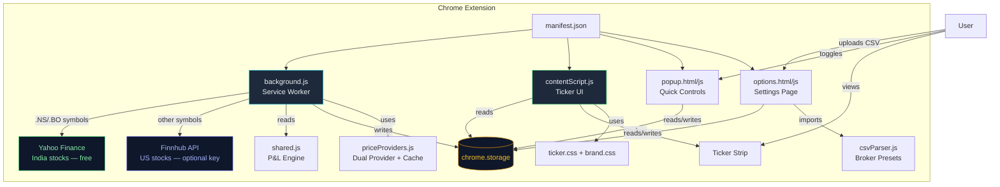

<p align="center">
  
</p>

<h1 align="center">MyTicker</h1>

<p align="center">
  <strong>A live portfolio ticker for Indian and US stocks — NSE/BSE data free, no API key needed.</strong><br/>
  See your portfolio's 5-minute and daily P&L on every browser tab, powered by real-time market data.
</p>

<p align="center">
  
  
  
  
</p>

---

## 🌟 What Makes It Different

- **Free Indian stock prices, zero configuration.** NSE and BSE prices come from Yahoo Finance automatically. No signup, no API key, no cost. Just import your broker CSV and prices appear.

- **Auto-detects your broker.** Drop a Zerodha, Groww, or Upstox CSV — the extension reads the column headers and selects the right parsing format automatically. No manual preset selection needed.

- **Dual-provider, single experience.** India (`.NS` / `.BO` symbols) → Yahoo Finance, completely free. US stocks (NYSE/NASDAQ) → Finnhub, optional free API key. One popup, one ticker strip, both markets working side by side.

- **Watchlist alongside your portfolio.** Track stocks you're watching but don't own yet — NSE, BSE, or US symbols — with live prices, right in the popup next to your real holdings.

- **100% private.** Nothing leaves your browser except price API calls (Yahoo Finance for Indian stocks, Finnhub for US stocks). No account, no server, no analytics, no telemetry.

- **5-minute and daily P&L.** The ticker strip and popup both show today's P&L relative to the previous close — using the accurate per-exchange close price — not just raw prices.

---

## 📸 Screenshots

### Ticker Strip
A minimal, always-visible bar showing your portfolio performance on every page.


### Popup
At-a-glance P&L summary, top movers, watchlist, and live status — one click away.


### Settings
Apple-style configuration with drag-and-drop CSV import and connection testing.


---

## ✨ Features

| Feature | Description |
|---------|-------------|
| **Live Ticker Strip** | A sleek dark bar at the top of every page with scrolling stock prices |
| **5-min & Daily P&L** | Both short-window and full-day profit/loss for each holding |
| **Yahoo Finance (India)** | NSE `.NS` and BSE `.BO` prices — free, no API key, auto-routed by symbol suffix |
| **Finnhub (US stocks)** | NYSE/NASDAQ prices via free Finnhub API key — optional, only needed for US holdings |
| **Multi-Broker CSV Import** | Drag-and-drop CSVs from Zerodha, Groww, or Upstox — format auto-detected |
| **Watchlist** | Add any NSE/BSE/US symbol to a watchlist with live prices in the popup |
| **Keyboard Shortcut** | Toggle the ticker strip with `Ctrl+Shift+Y` |
| **First-run Onboarding** | 3-step setup wizard and popup checklist for new users |
| **Premium Dark UI** | Apple-minimal Obsidian Gold theme |
| **100% Local Data** | Holdings, settings, and API keys never leave your browser |
| **Test Connection** | Validate your Finnhub API key with one click |

---

## 🏗 Architecture



### Data Flow

```
CSV Upload → csvParser.js (auto-detects broker) → chrome.storage.local (holdings)
                                       ↓
           background.js (alarm poll) → priceProviders.js
                                            ├─ .NS/.BO symbols → Yahoo Finance (free)
                                            └─ other symbols   → Finnhub API (optional key)
                                       ↓
           shared.js (P&L engine) → chrome.storage.local (positionsState)
                                       ↓
           contentScript.js → Renders ticker strip on every page
```

---

## 🚀 Installation

### From Source (Developer Mode)

1. Clone the repo:
   ```bash
   git clone https://github.com/harshabala/myticker-extension.git
   ```
2. Open Chrome → `chrome://extensions`
3. Enable **Developer Mode** (top right toggle)
4. Click **Load unpacked** → select the cloned folder
5. Click the MyTicker icon in your toolbar

### Setup (~2 minutes)

On first install, **Settings opens automatically** with a 3-step wizard:

1. **API key** — **Indian stocks only?** Skip this — prices come from Yahoo Finance automatically. **US stocks?** Get a free key at [finnhub.io](https://finnhub.io/register) → paste → Save → Test connection.
2. **Import CSV** — drag-and-drop your Zerodha, Groww, or Upstox holdings export. The broker format is auto-detected from column headers (NSE symbols automatically get `.NS`).
3. **Go live** — visit any tab; today's P&L appears in the ticker strip and popup.

The extension popup shows a checklist until setup is complete.

---

## 📁 Project Structure

```
MyTicker/
├── manifest.json          # Extension manifest (MV3)
├── background.js          # Service worker: polling, P&L orchestration
├── contentScript.js       # Injected ticker strip UI
├── shared.js              # Core P&L engine + shared utilities
├── priceProviders.js      # Dual-provider: Yahoo Finance (India) + Finnhub (US)
├── csvParser.js           # CSV parser with auto-detecting broker presets

├── popup.html / popup.js  # Extension popup: P&L summary + watchlist
├── options.html / options.js  # Settings page UI
├── ticker.css             # Ticker strip styles + animations
├── brand.css              # Design tokens, motion, Obsidian Gold theme
├── onboarding.js          # First-run wizard logic
├── icons/                 # Extension icons (16/32/48/128px)
├── assets/                # README screenshots
└── test_fixtures/         # Test CSVs + unit tests
```

---

## 🧪 Testing

Run the unit test suite for the core P&L engine:

```bash
node test_fixtures/test_shared.mjs
```

```
40 passed, 0 failed
```

Tests cover: price snapshot merging, P&L calculations, stale data pruning, edge cases (null values, empty holdings, NaN inputs).

---

## 📋 Attributions

| Component | Source | Notes |
|-----------|--------|-------|
| India stock prices | [Yahoo Finance](https://finance.yahoo.com) | Unofficial chart API — free, no key required |
| US stock prices | [Finnhub](https://finnhub.io) | Free tier — API key required |
| Icon design | Original | SVG chart icon, MIT licensed |
| No external JS libraries | — | Pure vanilla ES modules, no bundler |

---

## 🔒 Privacy

- **All data stays local** in `chrome.storage` — nothing is sent to any server except price API calls (Yahoo Finance for Indian stocks, Finnhub for US stocks).
- Your Finnhub API key is stored in `chrome.storage.local` (never synced across devices).
- No analytics, no tracking, no telemetry.
- See [PRIVACY.md](PRIVACY.md) for the full privacy policy.

---

## 🗺 Roadmap

- [ ] Live broker API integrations (Zerodha Kite, Groww, Upstox)
- [ ] Light theme for the ticker strip
- [ ] Multiple watchlists
- [ ] Intraday sparkline charts in the popup
- [ ] Alerts & notifications for price targets
- [ ] Firefox / Edge support

---

## 👨‍💻 Developer

Built by [Harsha Balakrishnan](https://github.com/harshabala) — with a little help from AI coding agents.  
Questions, ideas, or bugs → [open an issue](https://github.com/harshabala/myticker-extension/issues) or reach out on GitHub.

---

## 📄 License

[MIT](LICENSE) © 2026 MyTicker Contributors
